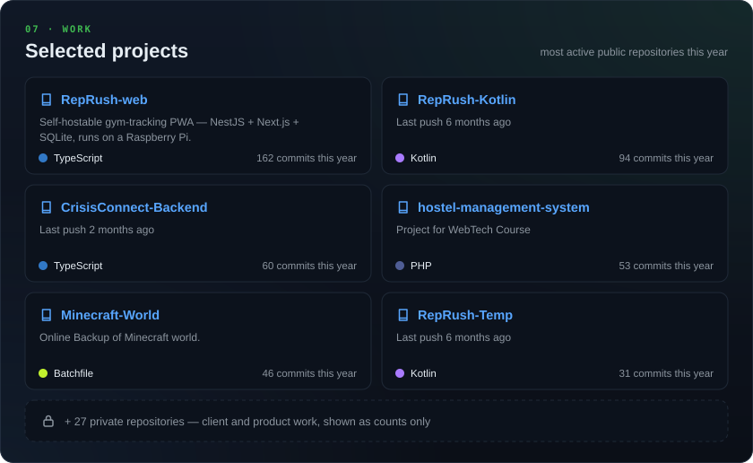
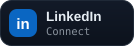
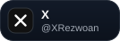
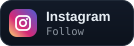
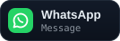
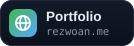

  

 

## 👋 About

- 🎓 CS student at **AIUB**, based in **Dhaka, Bangladesh**
- 🛠️ Full-stack web and backend: I build systems end to end, from the interface to the database
- ⌨️ Daily drivers: **VS Code**, **NeoVim**, Linux
- 🌱 Learning in public since 2021, shipping since 2023
- 🌐 Portfolio: [**rezwoan.me**](http://rezwoan.me)

 

## 📊 Stats

  

 

  

 

  

 

## ⚙️ Stack

  

 

  

 

## 🚀 Work

  

 

  

 

  

 

## 🌐 Connect

 

Built from live GitHub data, including private work. Refreshed every 6 hours.

