

  

 

  

 

  

 

  

 

  

 

  

 

  

 

  

 

  

 

  

 

<a href="https://rezwoan.codes" target="_blank">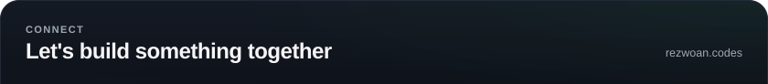</a>

<a href="https://www.linkedin.com/in/din-muhammad-rezwoan-b4b87020a" target="_blank">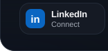</a><a href="https://twitter.com/XRezwoan" target="_blank">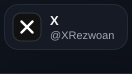</a><a href="https://www.facebook.com/ager.id.hack.hoye.gase" target="_blank">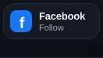</a><a href="https://www.instagram.com/din.muhammad.rezwoan" target="_blank">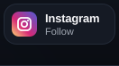</a><a href="https://wa.me/8801643751861" target="_blank">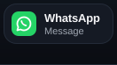</a><a href="https://rezwoan.codes" target="_blank">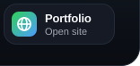</a>

 

Built from live GitHub data, including private work. Refreshed every 6 hours.

