  

 

## 👋 About

- 🎓 CS student at **AIUB**, based in **Dhaka, Bangladesh**
- 🛠️ Full-stack web and backend: I build systems end to end, from the interface to the database
- ⌨️ Daily drivers: **VS Code**, **NeoVim**, Linux
- 🌱 Learning in public since 2021, shipping since 2023
- 🌐 Portfolio: [**rezwoan.me**](http://rezwoan.me)

 

## 📊 Stats

  

 

  

 

  

3D skyline of my contributions, generated by GitHub Actions

 

## ⚙️ Stack

  

 

  

 

## 🚀 Work

  

 

### 💻 Currently working on

> _Repos updated in the last 30 days_

<!--START_SECTION:active-repos-->
_🕐 Last updated: Oct 26, 2026_

| | |
|---|---|
| **🌐 [dhaka-tesla-pool](https://github.com/Rezwoan/dhaka-tesla-pool)** Dhaka Tesla Pool -- ride-pooling MVP for the RoBenDevs Softw `Misc` ⭐ 0 🍴 0 |  |

<!--END_SECTION:active-repos-->

### 📡 Recent activity

<!--START_SECTION:activity-->
1. 💪 Opened PR [#692](https://github.com/Evavic44/portfolio-ideas/pull/692) in [Evavic44/portfolio-ideas](https://github.com/Evavic44/portfolio-ideas)
2. 🎉 Merged PR [#7](https://github.com/Rezwoan/CrisisConnect-Backend/pull/7) in [Rezwoan/CrisisConnect-Backend](https://github.com/Rezwoan/CrisisConnect-Backend)
3. 💪 Opened PR [#7](https://github.com/Rezwoan/CrisisConnect-Backend/pull/7) in [Rezwoan/CrisisConnect-Backend](https://github.com/Rezwoan/CrisisConnect-Backend)
4. 🚀 Published release [1.1.0](https://github.com/Rezwoan/Omarchy-PredatorSense/releases/tag/1.1.0) in [Rezwoan/Omarchy-PredatorSense](https://github.com/Rezwoan/Omarchy-PredatorSense)
<!--END_SECTION:activity-->

 

## 🐍 Contribution snake

  

 

## 🌐 Connect

  
  
  
  
  
  

 

