<div align="center">
  
</div>

<!-- ===== NEOFETCH TERMINAL ===== -->
<br/>

```console
$ neofetch --profile username

       /////////////////        root@rezwoan:~$
     /////////////////////      ---------------
   ///                 ///      OS:      CS Student @ AIUB
  ///   ///       ///   ///     KERNEL:  Problem Solver
 ///    ///       ///    ///    SHELL:   Full-Stack Web & Backend
 ///                     ///    UPTIME:  Learning since 2021
 ///   ///           /// ///    DE:      Dhaka, Bangladesh
  ///   /////////////// ///     EDITOR:  VS Code, NeoVim
   ///                 ///      PORT:    rezwoan.me
     /////////////////////      LINK:    github.com/Rezwoan
       /////////////////
```

<br/>

<!-- ===== SKIN: HOLO CARD ===== -->
<div align="center">
  
</div>

<br/>

<!-- ===== DYNAMIC FEEDS (TERMINAL STYLE) ===== -->
## 💻 `user@rezwoan:~$ cat currently_working_on.md`

> 🚀 _Live sync: Repos updated in the last 30 days_

<!--START_SECTION:active-repos-->
_🕐 Last updated: Oct 26, 2026_

| | |
|---|---|
| **🌐 [dhaka-tesla-pool](https://github.com/Rezwoan/dhaka-tesla-pool)**<br/>Dhaka Tesla Pool -- ride-pooling MVP for the RoBenDevs Softw<br/>`Misc` ⭐ 0 🍴 0 |  |

<!--END_SECTION:active-repos-->

<br/>

## 📡 `user@rezwoan:~$ tail -f recent_activity.log`

> ⏱️ _Live tracking: Latest commits & PRs on GitHub_

<!--START_SECTION:activity-->
1. 💪 Opened PR [#692](https://github.com/Evavic44/portfolio-ideas/pull/692) in [Evavic44/portfolio-ideas](https://github.com/Evavic44/portfolio-ideas)
2. 🎉 Merged PR [#7](https://github.com/Rezwoan/CrisisConnect-Backend/pull/7) in [Rezwoan/CrisisConnect-Backend](https://github.com/Rezwoan/CrisisConnect-Backend)
3. 💪 Opened PR [#7](https://github.com/Rezwoan/CrisisConnect-Backend/pull/7) in [Rezwoan/CrisisConnect-Backend](https://github.com/Rezwoan/CrisisConnect-Backend)
4. 🚀 Published release [1.1.0](https://github.com/Rezwoan/Omarchy-PredatorSense/releases/tag/1.1.0) in [Rezwoan/Omarchy-PredatorSense](https://github.com/Rezwoan/Omarchy-PredatorSense)
<!--END_SECTION:activity-->

<br/>

<!-- ===== HIGH CONTRAST TECH STACK ===== -->
## ⚙️ `user@rezwoan:~$ sudo apt install stack`

<div align="center">
  <a href="https://skillicons.dev">
    
  </a>
</div>

<br/>

<!-- ===== SKIN: SIGNAL RUN + NEON SKYLINE ===== -->
## 🛰️ `user@rezwoan:~$ ./signal_run --year`

<div align="center">
  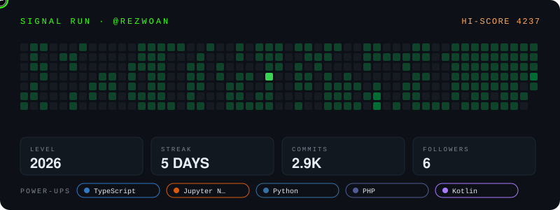
</div>

<div align="center">
  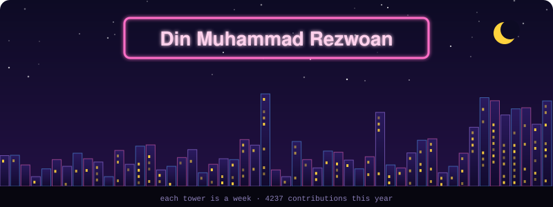
</div>

<br/>

<!-- ===== 3D ISOMETRIC CITY ===== -->
## 🏙️ `user@rezwoan:~$ ./render_3d_contributions.sh`

<div align="center">
  <picture>
    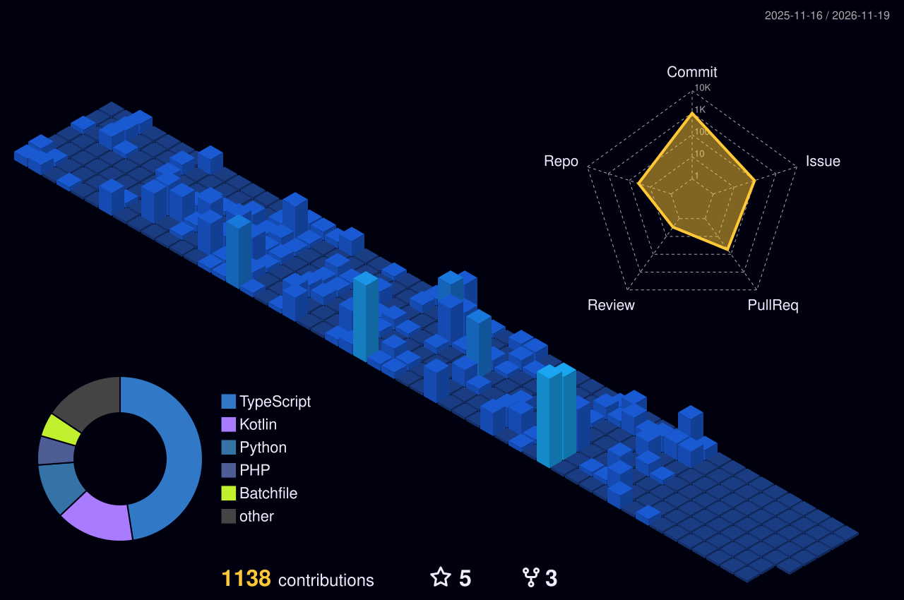
  </picture>
</div>
<p align="center"><em>Generated automatically via GitHub Actions</em></p>

<br/>

<div align="center">

<!--START_SECTION:htop-stats-->
<picture>
  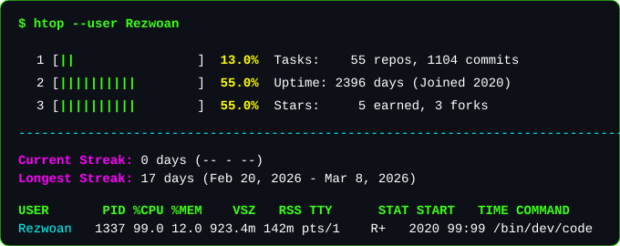
</picture>
<!--END_SECTION:htop-stats-->

</div>

<br/>

<!-- ===== SNAKE ANIMATION ===== -->
## 🐍 `user@rezwoan:~$ ./play_snake.py`

<div align="center">
  
</div>

<br/>

<!-- ===== SKIN GALLERY ===== -->
## 🎞️ `user@rezwoan:~$ ls skins/`

> 🎨 _Generated from my real GitHub data every 12 hours. Open a drawer._

<details>
<summary><b>🕹️ Arcade &amp; Games</b></summary>

<div align="center">
  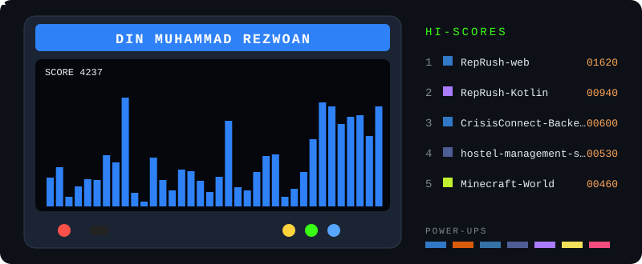
</div>

<div align="center">
  
</div>

<div align="center">
  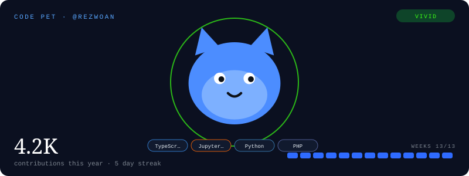
</div>

</details>

<details>
<summary><b>📊 Data Stories</b></summary>

<div align="center">
  
</div>

<div align="center">
  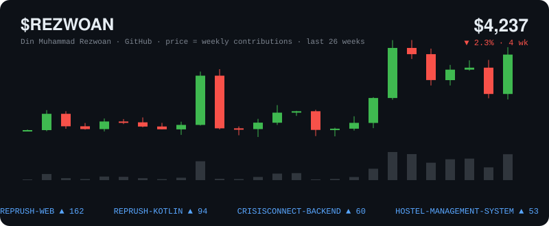
</div>

<div align="center">
  
</div>

<div align="center">
  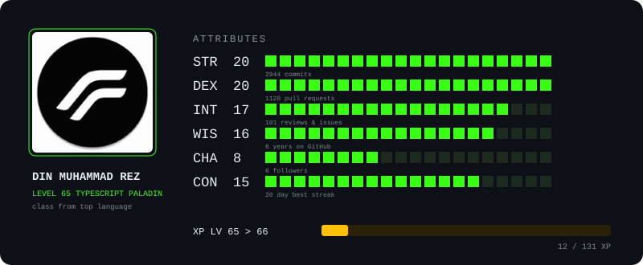
</div>

</details>

<details>
<summary><b>🌌 Worlds</b></summary>

<div align="center">
  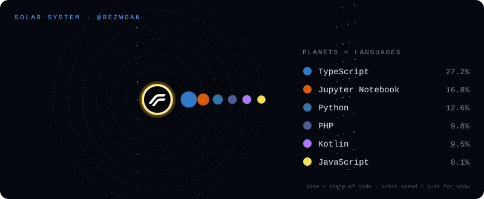
</div>

<div align="center">
  
</div>

<div align="center">
  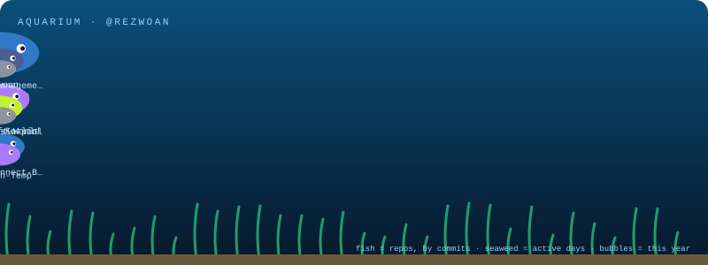
</div>

<div align="center">
  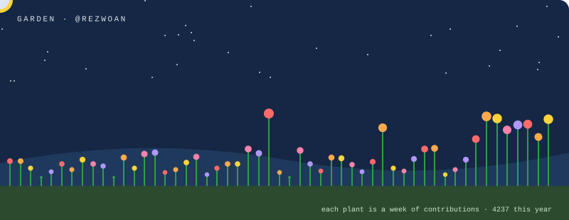
</div>

</details>

<details>
<summary><b>🎬 Media</b></summary>

<div align="center">
  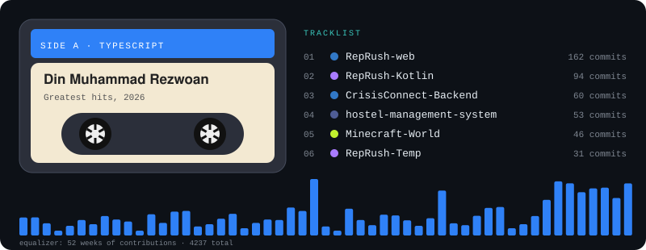
</div>

<div align="center">
  
</div>

<div align="center">
  
</div>

</details>

<br/>

<!-- ===== CONNECT ===== -->
## 🌐 `user@rezwoan:~$ ssh connect@socials`

<div align="center">
  <a href="https://www.linkedin.com/in/din-muhammad-rezwoan-b4b87020a" target="_blank">
    
  </a>&nbsp;
  <a href="https://twitter.com/XRezwoan" target="_blank">
    
  </a>&nbsp;
  <a href="https://www.facebook.com/ager.id.hack.hoye.gase" target="_blank">
    
  </a>&nbsp;
  <a href="https://www.instagram.com/din.muhammad.rezwoan" target="_blank">
    
  </a>&nbsp;
  <a href="https://wa.me/8801643751861" target="_blank">
    
  </a>
  &nbsp;
  <a href="http://rezwoan.me" target="_blank">
    
  </a>
</div>

<br/>

<!-- ===== FOOTER ===== -->
<div align="center">

```console
$ logout
Connection to rezwoan closed.
```

</div>

